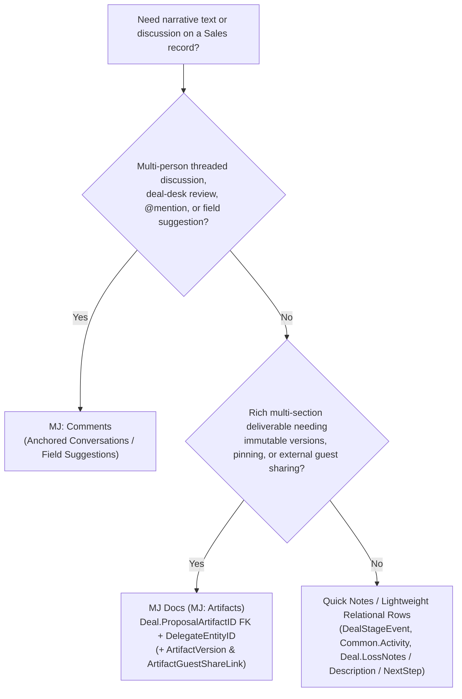

# MJ Docs (`MJ: Artifacts`) Deal Proposal & Executive Brief Integration — Living Specification

> **Status:** Slices 1 & 2 Complete (Architecture Rubric, Living Spec, Additive Dual-DBMS Schema `V202611261800`, CodeGen Entities, Delegated Permission Delegate & Dual-DBMS Seeded Integration Verification) · Slice 3 Pending
> **Epic Task ID:** `D882C5DB-ACF6-4FAF-AF0F-E750E1E8A862`
> **Approved FactoryPlan:** `B3C5C221-A983-4525-ACE2-69FFAAA13118` (v2 · `CriteriaHash: 0ede2ebae2e8f9cbdfdfcbe041151ef1d570637ff029e66a162dea8781550301`)
> **Repository & Branches:** `MemberJunction/bizapps-sales` · Target: `next` · Epic Branch: `factory/D882C5DB-ACF6-4FAF-AF0F-E750E1E8A862-mj-docs-deal-proposal`
> **Core Dependency Baseline:** Published `@memberjunction/*@6.3.0-edge.1`

---

## 1. Feature Overview & Architectural Scope

Enterprise deals routinely produce rich, multi-revision commercial deliverables — **Customer Proposals**, **Executive Deal Briefs**, and **Mutual Action Plans** — that require version history, version pinning at signature/approval checkpoints, delegated record permissions, and controlled external sharing with prospects (`ArtifactGuestShareLink`). At the same time, high-frequency pipeline metadata such as stage transitions (`DealStageEvent`), call/meeting logs (`Common.Activity`), and close-reason notes must stay lightweight relational rows so pipeline queries, close-lock auditing, and forecasting remain fast and deterministic.

This initiative integrates **MJ Docs (`MJ: Artifacts`)** into `bizapps-sales` against published `@memberjunction/*@6.3.0-edge.1` in three incremental slices:

```mermaid
flowchart LR
    subgraph S1["Slice 1 · Rubric & Living Spec (Complete)"]
        Docs["CLAUDE.md & AGENTS.md Rubric"]
        Spec[".mj/specs/mj-docs-deal-proposal-integration.md"]
        Readme["README.md Index"]
    end

    subgraph S2["Slice 2 · Additive Schema, PG Parity & Seeded Verification (Complete)"]
        MigSQL["migrations/V202611261800__v6.35.x__Deal_ProposalArtifactID.sql<br/>(4-part T-SQL, PUBLISH_NO_BREAK_POLICY)"]
        MigPG["migrations-pg/V202611261800__v6.35.x__Deal_ProposalArtifactID.pg.sql<br/>(split-bake v1 deterministic PG parity)"]
        Entities["packages/Entities CodeGen + Unit Tests +<br/>DealArtifactPermissionDelegate"]
        Seed["scripts/seed-sales-deals.{sql,pg.sql} +<br/>packages/IntegrationTests DPA1–DPA6 dual-DBMS checks"]
    end

    subgraph S3["Slice 3 · Angular @memberjunction/ng-artifacts UI & Readiness"]
        NgPanel["packages/Angular Deal Proposal Preview Panel<br/>(OnPush, race guard, --mj-* tokens)"]
        Readiness["Unit Tests + Headless Chromium Playwright +<br/>OpenApp v3 Readiness + Package READMEs"]
    end

    S1 --> S2 --> S3
```



---

## 2. MJ Docs (`MJ: Artifacts`) vs. `MJ: Comments` vs. Quick Notes Decision Rubric

Contributors and autonomous agents designing any new narrative, collaboration, or note capability in `bizapps-sales` MUST choose the simplest storage primitive matching the data's lifecycle:



| Dimension | MJ Docs (`MJ: Artifacts`) | `MJ: Comments` | Quick Notes / Lightweight Relational Rows |
|---|---|---|---|
| **Sales Use Cases** | Customer Proposals, Executive Deal Briefs, Mutual Action Plans | Threaded deal-desk review commentary, approval Q&A, `@mentions`, field suggestions | `DealStageEvent` transition provenance, quick call/email/meeting logs (`Common.Activity`), `Deal.LossNotes`, `Deal.Description`, `Deal.NextStep` |
| **Storage & Link** | `[__mj].[Artifact]` + `[__mj].[ArtifactVersion]` + `[__mj].[ArtifactGuestShareLink]`, linked via `[__mj_BizAppsSales].[Deal].[ProposalArtifactID]` (`UNIQUEIDENTIFIER NULL FK -> [__mj].[Artifact]([ID])`) | `[__mj].[Conversation]` → IS-A `MJ: Comments` anchored to `(EntityID, RecordID)` | Columns on `[__mj_BizAppsSales].[Deal]`, `[__mj_BizAppsSales].[DealStageEvent]`, or `[__mj_BizAppsCommon].[Activity]` |
| **Versioning & Sharing** | Full immutable `MJ: Artifact Versions`, version pinning, and external magic-link sharing via `ArtifactGuestShareLink` | Chronological comment thread with resolution state | Append-only `DealStageEvent` or standard MJ `RecordChange` audit trail |
| **Security & Governance** | Delegated host-record permissions via `Artifact.DelegateEntityID` / `Artifact.DelegateRecordID` + `ArtifactPermissionEngine` | Automatic RLS (`UserCanReadLinkedRecord`) + two-stage FLS | Sales entity RLS/FLS + `DealEntityServer` close-lock immutability (`close-lock.ts`) |
| **UI Surface** | `@memberjunction/ng-artifacts` preview panel (`OnPush`, `--mj-*` tokens, zero `window.print()`) | `<mj-record-comments>` built into Explorer record chrome | Standard `<mj-form-field>` inputs and `DealActivityTimelineComponent` |

### Non-Goals

- **No migration of operational notes into `MJ: Artifacts`**: `DealStageEvent` provenance, `Common.Activity` call/activity logs, and close-reason notes (`Deal.LossNotes`) stay lightweight relational rows.
- **No breaking schema changes**: Never drop, rename, narrow, or make `NOT NULL` (without default) any existing column, table, view, or SP parameter on `[__mj_BizAppsSales].[Deal]` in violation of `PUBLISH_NO_BREAK_POLICY.md`.
- **No custom rich-text document editor**: Do not duplicate `@memberjunction/ng-artifacts` editing or collaboration primitives inside `bizapps-sales`.
- **No unpublished MJ core changes**: Everything must compile cleanly against published `@memberjunction/*@6.3.0-edge.1`.
- **No client-side `window.print()`**: Rely on `@memberjunction/ng-artifacts@6.3.0-edge.1` native export capabilities rather than browser print dialogs or unrequested net-new backend PDF action packages.
- **No TypeScript or MJ hygiene regressions**: Zero `any`, zero lazy `unknown` casts, zero legacy `.Get()`/`.Set()` where generated properties exist, zero cross-package re-exports, zero `localStorage`.

### Alternatives Considered

| Alternative | Why Rejected |
|---|---|
| Store customer proposals and executive briefs as plain `NVARCHAR(MAX)` Markdown columns directly on `[__mj_BizAppsSales].[Deal]` | Duplicates version history, version pinning, and external guest sharing (`ArtifactGuestShareLink`) already provided by `MJ: Artifacts` and bloats high-frequency pipeline/forecast queries. |
| Move all sales notes, call logs, and stage transition reasons into `MJ: Artifacts` | Adds excessive artifact overhead for short structured provenance events (`DealStageEvent`, `Common.Activity`, `LossNotes`) that require fast relational filtering, reporting, and close-lock enforcement. |
| Hand-author a bespoke PostgreSQL `.pg.sql` migration via LLM or legacy `mj sql-convert` | Violates the deterministic `pg-migrate-parity` split-bake standard and risks subtle 6-category schema drift between SQL Server and PostgreSQL. |
| Add a browser `window.print()` button on the proposal preview for PDF export | Produces unstyled browser print dialogs that fail in headless/embedded contexts; export stays delegated to `@memberjunction/ng-artifacts` or server-side `BaseAction` (`pdfkit`) mechanisms. |

---

## 3. Grounded Repository Layout (Reference for Slices 2 & 3)

Verified directly against `MemberJunction/bizapps-sales` on `origin/next` (`b60e696093f6f1dfb4bc53541a5ba0342a24e34f`) before Slice 2/3 execution:

- **Default / Integration Branch**: `origin/HEAD -> origin/next` (`next` is the active integration branch for feature PRs; `main` is the release branch; `lts/*` are release lines).
- **Migrations (flat directories — NOT `migrations/v6/`)**:
  - `migrations/` — 44 SQL Server migrations from `B202608042100__v0.1.x__Schema.sql` through `V202611241945__v6.34.x__Metadata_Sync.sql`. Slice 2 MUST place its new additive 4-part T-SQL migration directly in `migrations/` with a timestamp strictly newer than `202611241945` (enforced by `.github/workflows/changes.yml` timestamp watermark check).
  - `migrations-pg/` — 28 PostgreSQL `.pg.sql` counterparts from `V202610131430__v6.14.x__Metadata_Sync.pg.sql` through `V202611241945__v6.34.x__Metadata_Sync.pg.sql`. Slice 2 MUST place its deterministic split-bake `.pg.sql` counterpart in `migrations-pg/`.
  - `migrations-teardown/` — `V001__Retire_Sales_Core_Rows.sql`.
- **`mj-app.json`**:
  - `name: "mj-bizapps-sales"`, `version: "6.32.0"`, `mjVersionRange: ">=6.3.0-edge.1 <7.0.0"`, `schema.name: "__mj_BizAppsSales"`, `migrations: { directory: "migrations", engine: "skyway", teardownDirectory: "migrations-teardown" }`.
  - `packages.server`: `@mj-biz-apps/sales-server` (`startupExport: "LoadBizAppsSalesServer"`).
  - `packages.client`: `@mj-biz-apps/sales-ng` (`startupExport: "LoadBizAppsSalesClient"`).
  - `packages.shared`: `@mj-biz-apps/sales-entities`, `@mj-biz-apps/sales-actions`.
- **`packages/` (Title-case directories; `@memberjunction/*` anchored at `6.3.0-edge.1` devDep / `^6.3.0-edge.1` peer)**:
  - `packages/Entities` → `@mj-biz-apps/sales-entities@6.32.0` (generated entity subclasses in `src/generated/`, `close-lock.ts`, `sales-engine-base.ts`, unit tests in `src/__tests__/`).
  - `packages/Actions` → `@mj-biz-apps/sales-actions@6.32.0`.
  - `packages/CoreEntitiesServer` → `@mj-biz-apps/sales-core-entities-server@6.32.0` (`DealEntityServer.ts`, close-lock enforcement, unit tests in `src/__tests__/`).
  - `packages/Server` → `@mj-biz-apps/sales-server@6.32.0`.
  - `packages/Angular` → `@mj-biz-apps/sales-ng@6.32.0` (`DealFormComponentExtended` priority-2 `BaseFormComponent` in `src/lib/custom/deal-form.component.ts`, 12 `MJSDeal*Panel` `BaseFormPanel` registrations in `src/lib/form-panels/`, `SalesDealsSectionResource` `BaseResourceComponent` in `src/lib/sections/sales-section.component.ts`, `LoadBizAppsSalesClient()` in `src/public-api.ts`, unit/DOM tests in `src/__tests__/`). Note: `@memberjunction/ng-artifacts` is NOT yet listed in `packages/Angular/package.json` — Slice 3 adds it as caret peer `^6.3.0-edge.1` and exact devDep `6.3.0-edge.1`.
  - `packages/IntegrationTests` → `@mj-biz-apps/sales-integration-tests@6.32.0` (private; check bundles in `src/checks/*.checks.ts`, shared fixture in `src/fixture.ts`, registered check counts in `scripts/expected-check-counts.json`, runner in `test-harnesses/integration.mjs`).
  - Note: No `packages/*/README.md` currently exists on `next`; Slices 2 & 3 will author `packages/Entities/README.md` and `packages/Angular/README.md` in lockstep with code changes (plus a `minor` changeset in `.changeset/`).
- **`metadata/`**: 35 subdirectories including `applications/.bizapps-sales-application.json` (`DefaultNavItems` → `SalesDealsSectionResource`), `entities/.entities.json`, `entities/.form-chrome.json`, `entity-fields/*.json`, `entity-relationships/`, and `queries/`.
- **`docs/ux/`**: Not present in `bizapps-sales` (no HTML mockup files exist). Slice 3 aligns visual hierarchy, rail chrome, cards, and spacing directly with the existing `MJSDeal*Panel` system (`deal-form.panels.ts`, `deal-hero.panel.ts`) and MJ L0–L3 UX layering using `--mj-*` tokens from `scripts/mj-tokens.json`.
- **`scripts/`**: 24 scripts + `scripts/dev/` covering static gates (`test:vocabulary-gate`, `test:money-gate`, `test:token-gate`, `test:drift-gate`, `test:discount-gate`, `test:validation-gate`, `test:spec-gate`, `test:selector-gate`, `lint:distribution`, `check:release-seed`), DB rebuild (`rebuild-db.sh`), and seeds (`seed-dev-data.sh`, `seed-demo-data.sh`, `seed-demo-lines.mjs`, `scripts/dev/seed-*.sql`).
- **`.github/workflows/`**: 12 workflows (`ci.yml`, `build.yml`, `repo-checks.yml`, `caret-pins.yml`, `changes.yml`, `distribution-gate.yml`, `release-lines-gates.yml`, `release-readiness.yml`, `release.yml`, `publish.yml`, `version.yml`, `backport.yml`). Note that `changes.yml` currently runs `check-pg-counterpart.sh` at `warning` level on PRs; Slice 2/3 verifies CI enforces build, unit tests, static gates, and PG parity cleanly on PRs targeting `next`.
- **Core `@memberjunction/core-entities@6.3.0-edge.1` Schema Grounding (resolving Slice 2 seed open questions)**:
  - `[__mj].[Artifact]` (`MJ: Artifacts`) carries `DelegateEntityID` and `DelegateRecordID` for host-record permission delegation.
  - `[__mj].[ArtifactVersion]` (`MJ: Artifact Versions`) stores immutable version snapshots referenced by `ArtifactID` and `VersionNumber`.
  - `[__mj].[ArtifactGuestShareLink]` (`MJ: Artifact Guest Share Links`) is confirmed present in `@memberjunction/core-entities@6.3.0-edge.1` with columns `ID`, `MagicLinkInviteID` (`FK -> [__mj].[MagicLinkInvite]`), `ArtifactID` (`FK -> [__mj].[Artifact]`), `ArtifactVersionID` (`FK -> [__mj].[ArtifactVersion]`), `CreatedByUserID` (`FK -> [__mj].[User]`), and `Label` (`nvarchar(200) NULL`).

---

## 4. Grounded Critical User Journeys (CUJ-1 through CUJ-4)

### CUJ-1 — Enterprise Account Executive: Reviewing a Deal Proposal / Executive Brief & Handling Empty/Unauthorized States
1. **Linked Happy Path**: An Enterprise AE opens an active Deal record (`DealFormComponentExtended`) in the Sales OpenApp, selects the Proposal / Executive Brief panel, and views the linked `MJ: Artifacts` document rendered inline via `@memberjunction/ng-artifacts` alongside pinned version metadata and optional external guest share link status — without leaving the Deal workspace or disrupting standard Deal form fields and stage history.
2. **Empty / Unlinked State (`ProposalArtifactID === null`)**: When opening an early-stage or legacy Deal with `ProposalArtifactID === null`, the panel renders a clean, domain-neutral empty state (zero errors, zero spinner lockups) clearly indicating no Proposal or Executive Brief is linked yet.
3. **Unauthorized / Error State**: When the linked `ProposalArtifactID` cannot be read by the current user (e.g., restricted permissions or deleted artifact) or the load fails, the panel displays a clear non-blocking access/error message without leaking raw Markdown, stack traces, or breaking sibling Deal panels.
4. **Rapid Deal Switching**: Switching rapidly between a Deal with a populated `ProposalArtifactID` and one with `ProposalArtifactID === null` (or a different artifact) cancels or discards stale in-flight `RunView` responses via a request-token / `switchMap` guard so the UI never displays the previous Deal's proposal.

### CUJ-2 — Sales Operations Engineer / DBA: Dual-DBMS Additive Migration & Legacy Compatibility
1. Runs Skyway `mj migrate` and `mj sync push --dir metadata --ci` (with **zero deploy-time `mj codegen`**) against both SQL Server and PostgreSQL environments.
2. Verifies 100% 6-category SQL Server ↔ PostgreSQL schema-delta equivalence (tables, columns, constraints, views, routines, indexes) and confirms `-- @mj-pg-provenance: split-bake v1` on line 1 of the `.pg.sql` file.
3. Executes the dual-DBMS seeded integration suite (`sf-workspace-db-broker.mjs rehearse-dual-db` + `packages/IntegrationTests` + `test-harnesses/integration.mjs`) and confirms existing legacy Deals with `ProposalArtifactID IS NULL` continue to load, validate, save, close, and report with zero breaking changes.

### CUJ-3 — Contributor / Autonomous Coding Agent: Applying the Storage Rubric
1. Reads `CLAUDE.md` and `AGENTS.md` before designing any new narrative, comment, or note feature in `bizapps-sales`.
2. Applies the 3-way rubric deterministically: customer-facing versioned deliverables → `MJ: Artifacts`; threaded collaboration → `MJ: Comments`; structured provenance/call/close notes → lightweight relational columns/rows.

### CUJ-4 — Deal Desk / Account Executive & Adversarial Permission Verification (AC-5)
1. Links or updates `Deal.ProposalArtifactID` on an open Deal to a versioned `MJ: Artifacts` proposal/brief with `DelegateEntityID` / `DelegateRecordID` bound to the Deal, a pinned `MJ: Artifact Versions` snapshot, and an `MJ: Artifact Guest Share Links` binding (`MagicLinkInviteID`, `ArtifactID`, `ArtifactVersionID`, `CreatedByUserID`, `Label`).
2. Verifies persistence, audit trail, and close-lock immutability (`DealEntityServer.Save()` refuses unauthorized mutations to frozen fields on locked Deals while accepting valid edits on open Deals and preserving nullability when unlinking).
3. Executes adversarial boundary checks across SQL Server and PostgreSQL:
   - An unauthorized user who lacks read access to the Deal or delegated Artifact is denied access to the linked proposal/version metadata.
   - Attempting to save an invalid/non-existent `ProposalArtifactID` fails cleanly at the foreign-key / server validation boundary without leaving partial state.
   - All live CRUD mutation probes execute inside rolled-back transactions (`BaseLiveCrudVerifier.WithRolledBackTransaction` / integration runner rollback) leaving the database pristine.

---

## 5. Slice 2 Contract — Additive Schema, PostgreSQL Parity, CodeGen & Seeded Verification

### 5.1 Additive T-SQL Migration (`migrations/`)
- **Strict `PUBLISH_NO_BREAK_POLICY.md` compliance**: Purely additive column, FK, and filtered index on `[${flyway:defaultSchema}].[Deal]`:
  ```sql
  ALTER TABLE [${flyway:defaultSchema}].[Deal]
      ADD [ProposalArtifactID] UNIQUEIDENTIFIER NULL
          CONSTRAINT [FK_Deal_ProposalArtifact]
              FOREIGN KEY REFERENCES [${mjSchema}].[Artifact]([ID]);
  GO

  CREATE NONCLUSTERED INDEX [IX_Deal_ProposalArtifactID]
      ON [${flyway:defaultSchema}].[Deal] ([ProposalArtifactID])
      WHERE [ProposalArtifactID] IS NOT NULL;
  GO
  ```
- Include `sp_addextendedproperty` `MS_Description` on `Deal.ProposalArtifactID`.
- Follow the 4-part migration format:
  1. Hand-written additive DDL (`ALTER TABLE`, `CREATE INDEX`, `sp_addextendedproperty`).
  2. 50+ blank lines separator.
  3. CodeGen banner comment.
  4. CodeGen-generated `EntityField` insert (dynamic `MAX(Sequence) + 1`, never a literal placeholder, and never `spDeleteUnneededEntityFields`), refreshed `vwDeals`, regenerated `spCreateDeal` / `spUpdateDeal` (with `@ProposalArtifactID uniqueidentifier = NULL` tolerant optional signature), and grants.

### 5.2 Deterministic PostgreSQL Parity (`migrations-pg/`)
- Generated strictly via workspace `MJCLI` (`mj migrate convert --split --bake-codegen` with `--schema __mj_BizAppsSales --core-schema __mj`).
- If `.pg.sql.needs-hand` is emitted, translate ONLY the bounded hand block, apply hand DDL to the working PG database, and run `mj migrate rebake --capture-only` so CodeGen output is 100% natively baked.
- Stamp line 1 with:
  ```sql
  -- @mj-pg-provenance: split-bake v1 source=<filename.sql> source-sha256=<64hex> mode=<baked|needs-hand-rebaked>
  ```
- Must pass `sf-workspace-db-broker.mjs rehearse-dual-db`: clean Skyway `mj migrate` + `mj sync push --dir metadata --ci` (zero deploy-time `mj codegen`) and 6-category schema-delta equivalence across SQL Server and PostgreSQL.

### 5.3 Metadata, Entity Classes & Seeded Integration Fixtures
- Declarative field metadata under `metadata/entity-fields/` (labels/descriptions, `EntityIDFieldName` hygiene verified, no `sync` block, no hand-written `Metadata_Sync.sql`).
- CodeGen regenerates `DealEntity.ProposalArtifactID: string | null` and `DealEntity.ProposalArtifact: string | null` in `packages/Entities/src/generated/` and generated form bindings in `packages/Angular/src/lib/generated/`.
- Verify `packages/Entities/src/close-lock.ts` label derivation (`DealFieldLabel('ProposalArtifactID')` → `'Proposal Artifact'`) and lock behavior (frozen once locked unless reopened via `Sales.ReopenDeal`).
- Author realistic multi-entity seed fixtures in lockstep across SQL Server (`scripts/seed-sales-deals.sql`) and PostgreSQL (`scripts/seed-sales-deals.pg.sql`) plus `packages/IntegrationTests/` (`>= 20` Deals spanning open/won/lost statuses and periods, accounts, contacts, roles, permissions, linked Customer Proposal / Executive Deal Brief `Artifact` rows, pinned `ArtifactVersion` snapshots, and `ArtifactGuestShareLink` rows) and execute functional + adversarial permission boundary checks via `test-harnesses/integration.mjs`.

---

## 6. Slice 3 Contract — Angular `@memberjunction/ng-artifacts` UI & OpenApp Readiness

- **Package Dependency Hygiene (`check-dependency-model.mjs`)**: Add `@memberjunction/ng-artifacts` to `packages/Angular/package.json` as `"^6.3.0-edge.1"` in `peerDependencies` and `"6.3.0-edge.1"` in `devDependencies` (never `dependencies`).
- **Component Architecture (`packages/Angular`)**:
  - Contribute a dedicated standalone Proposal / Executive Brief `BaseFormPanel` (`@RegisterClassEx(BaseFormPanel, ...)` with `inclusion: 'Primary'`, PascalCase public members, `@if`/`@for`/`@switch`, `inject()`) onto `DealFormComponentExtended` (`'MJ_BizApps_Sales: Deals'`) and retain it with a `void` anchor in `LoadBizAppsSalesClient()` (`packages/Angular/src/public-api.ts`).
  - Render linked `MJ: Artifacts` content via `@memberjunction/ng-artifacts` (`@memberjunction/*@6.3.0-edge.1`) with version metadata and optional guest share link status, plus clean empty (`ProposalArtifactID === null`), loading (`<mj-loading>`), and unauthorized/error states.
  - **Async Race Guard**: Track an incrementing request token (or RxJS `switchMap`) keyed on `(Deal.ID, Deal.ProposalArtifactID)` so stale async `RunView` responses from rapid Deal switching or null resets are discarded before mutating component state.
  - **Batched Data Access (5-Rule Standard)**: Use a single `RunView` / `RunViews([...])` call with `ResultType: 'simple'` and explicit `Fields` for artifact/version/guest-share metadata (zero `RunView` loops, zero `vw*` subqueries in `ExtraFilter`, zero global transactional caches).
  - **Strict UI & OpenApp v3 Hygiene**:
    - `ChangeDetectionStrategy.OnPush` + `ChangeDetectorRef.markForCheck()` / `detectChanges()`.
    - Semantic `--mj-*` CSS custom properties exclusively (must exist in `scripts/mj-tokens.json`; `pnpm run test:token-gate` green; zero raw `#hex`, `rgb()`, `rgba()`, or `hsl()` literals).
    - `UserInfoEngine.Instance` for any persisted UI preferences — **zero `localStorage`**.
    - Defer `NotifyLoadStarted()` via `queueMicrotask` where used; call `NotifyLoadComplete()` on every `BaseResourceComponent`.
    - **Zero `window.print()`** calls anywhere in `packages/Angular`.
    - Prototype-safe checks (`Object.prototype.hasOwnProperty.call(...)`) for any custom-element / zone.js boundary.
    - **Dual Form Registration Parity**: Keep every entity's `@RegisterClass(BaseFormComponent, '<EntityName>')` active and verify via `MJGlobal.Instance.ClassFactory.GetRegistration(BaseFormComponent, 'MJ_BizApps_Sales: Deals')` and all Sales entities in Vitest.
    - **Navigation & Resource Parity**: Keep `SalesDealsSectionResource` (`BaseResourceComponent`) anchored in `LoadBizAppsSalesClient()` and matched with `metadata/applications/.bizapps-sales-application.json` `DefaultNavItems`.
- **Verification**:
  - Vitest unit/DOM tests (`DealProposalPreview.component.spec.ts`, `OpenAppRegistrationAndTokens.spec.ts`, `DealProposalArtifact.test.ts`, `StaticHygiene.test.ts`) 100% green with zero `.skip`.
  - Headless Chromium Playwright smoke verification across linked, empty, and unauthorized/error states: `pageErrors === 0`, `consoleErrors === 0`, loaded icon font CSS, domain-neutral copy, and zero raw Markdown leaks in rendered DOM.
  - Synchronize `packages/Entities/README.md`, `packages/Angular/README.md`, root `README.md`, and this spec with final implementation and add a `minor` changeset in `.changeset/`.

---

## 7. Acceptance Criteria & Required Verification Artifacts

| AC / Artifact | Scope | Target Verification |
|---|---|---|
| **AC-1 / `ART-8`** | `CLAUDE.md`, `AGENTS.md`, `README.md`, `.mj/specs/mj-docs-deal-proposal-integration.md` (+ `packages/Entities/README.md` & `packages/Angular/README.md` in Slices 2–3) | Authoritative 3-way rubric & living specification synchronized across repo docs |
| **AC-2 / `ART-3`, `ART-4`** | `migrations/`, `migrations-pg/` | Strictly additive 4-part T-SQL + deterministic `split-bake v1` `.pg.sql`, 6-category schema-delta equivalence, clean `mj migrate` + `mj sync push --dir metadata --ci` |
| **AC-3 / `ART-1`, `ART-2`** | Workspace build & `.github/workflows/ci.yml` | Clean `pnpm build` on `@memberjunction/*@6.3.0-edge.1`, zero `any`/`unknown`, zero `.Get()`/`.Set()`, CI gates verified |
| **AC-4 / `ART-2`** | `packages/Entities/src/__tests__/`, `packages/Angular/src/__tests__/` | 100% green `pnpm test` covering typing, batched `RunView`, preview/empty/error/race-guard states, token hygiene, zero `window.print()`/`localStorage`, Dual Form Registration Parity |
| **AC-5 / `ART-4`, `ART-7`** | `scripts/seed-sales-deals.{sql,pg.sql}`, `packages/IntegrationTests/`, `test-harnesses/integration.mjs` | `>= 20` realistic seeded Deals with linked artifacts, pinned versions, and `ArtifactGuestShareLink` rows passing dual-DBMS functional & adversarial checks |
| **AC-6 / `ART-5`, `ART-6`** | `packages/Angular`, `mj-app.json`, `metadata/applications/` | Headless Chromium Playwright multi-view verification (`0 pageErrors`, `0 consoleErrors`, loaded icon CSS, zero raw Markdown leaks) + OpenApp v3 readiness report |
